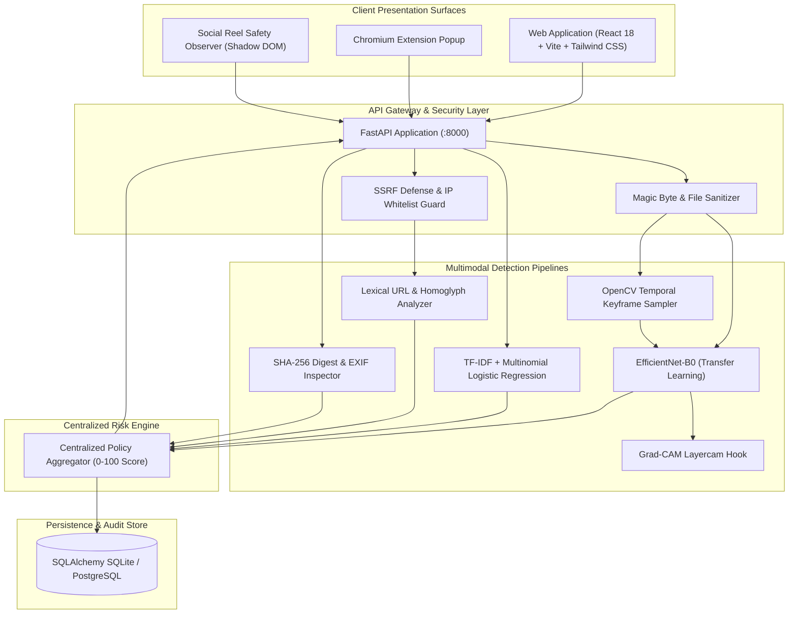

# MediaTrust: Real-Time Digital Trust and Safety Layer
### AI-Powered Deepfake Detection, Scam Detection, Social Reel Safety Monitoring & Impersonation Analysis Platform

[](https://github.com/mediatrust/mediatrust)
[](LICENSE)
[](https://python.org)
[](https://react.dev)
[](https://developer.chrome.com/docs/extensions/mv3/intro/)

---

## 1. Project Introduction & Problem Statement

Digital deception has rapidly evolved beyond crude phishing emails. With modern diffusion pipelines (Stable Diffusion, Midjourney, Flux) and automated voice/video manipulation, synthetic media and automated scams circulate virally on social media platforms. Users encounter deceptive investment reels, brand spoofing websites, and impersonation attempts without accessible tools to evaluate digital trustworthiness.

**MediaTrust** is a unified, student research prototype for cybersecurity and machine learning engineered to address this crisis. MediaTrust bridges the gap between deep-learning research and real-world browsing by providing:
1. **Real-time automated social reel monitoring** directly inside Chrome and Edge browsers.
2. **Explainable AI models** (Grad-CAM heatmaps and token feature contributions) that avoid opaque assertions.
3. **Separate visual and scam signals**: AI-generated-image scores and the ResNeXt50+LSTM face-deepfake sequence score are informational; scam risk relies on suspicious URL evidence and concrete credential/payment indicators.
4. **Content integrity & provenance audits** leveraging cryptographic SHA-256 digests and EXIF metadata.

---

## 2. System Architecture



---

## 3. Technology Stack

- **Frontend Website**: React 18, TypeScript, Vite, Tailwind CSS, Lucide Icons, Recharts, React Router v6.
- **Backend API**: Python 3.11+, FastAPI, Pydantic v2, Uvicorn, SQLAlchemy 2.0 ORM, SQLite (local) / PostgreSQL (production).
- **Machine Learning**: PyTorch 2.x, Torchvision, Scikit-Learn, OpenCV (`opencv-python-headless`), Pillow, NumPy, SciPy.
- **Browser Extension**: Chrome Extension Manifest V3, TypeScript/ESM, Isolated Shadow DOM, Content Scripts, Service Worker.
- **Testing & Tooling**: Pytest, FastAPI TestClient, Git, GitHub Actions CI.

---

## 4. Repository Structure

```
MediaTrust/
├── .github/workflows/ci.yml       # Automated CI pipeline
├── .env.example                   # Environment configuration template
├── .gitignore                     # Git exclusion rules
├── Dockerfile                     # Production backend Docker container
├── docker-compose.yml             # Orchestration descriptor
├── LICENSE                        # MIT License
├── README.md                      # Master project documentation
├── docs/                          # Comprehensive B.Tech engineering docs
│   ├── architecture.md            # UML, DFD Levels 0, 1, 2, State & ER Diagrams
│   ├── srs.md                     # Software Requirements Specification
│   ├── ml-methodology.md          # Mathematical formulas, Grad-CAM, loss functions
│   ├── model-card.md              # Machine learning model cards
│   ├── threat-model.md            # STRIDE threat model & SSRF defense
│   ├── test-plan.md               # Automated testing & verification report
│   ├── deployment.md              # Container & production deployment guide
│   ├── user-guide.md              # Comprehensive web & extension user guide
│   ├── datasets.md                # Datasets & benchmark acquisition
│   ├── api-reference.md           # REST API endpoints reference
│   └── limitations.md             # Documented technical boundaries
├── frontend/                      # React 18 + Vite Web Application
│   ├── package.json
│   ├── vite.config.ts
│   ├── tailwind.config.js
│   ├── src/
│   │   ├── components/            # Reusable UI (GradCamViewer, RiskBadge, EvidenceTable)
│   │   ├── pages/                 # Landing, Workspace, Detail, History, Models
│   │   ├── services/api.ts        # Typed API client
│   │   └── types/                 # TypeScript interfaces
├── extension/                     # Chrome / Edge Manifest V3 Extension
│   ├── manifest.json
│   ├── test_feed.html             # Local social video feed test environment
│   ├── icons/                     # Standard extension icons
│   ├── src/
│   │   ├── background/index.js    # Service worker & context menus
│   │   ├── content/index.js       # Real-time reel observer & Shadow DOM warning
│   │   ├── popup/                 # Toolbar quick-check interface
│   │   └── options/               # User configuration panel
├── backend/                       # FastAPI REST API & Machine Learning
│   ├── requirements.txt
│   ├── pyproject.toml
│   ├── app/
│   │   ├── main.py                # FastAPI entry point & CORS
│   │   ├── api/v1/endpoints.py    # REST routes (/analyze, /analyses, /models)
│   │   ├── core/config.py         # Application settings
│   │   ├── database/session.py    # Database connection generator
│   │   ├── models/analysis.py     # SQLAlchemy ORM models
│   │   ├── schemas/analysis.py    # Pydantic schemas
│   │   ├── security/              # SSRF guard & magic byte validator
│   │   ├── ml/                    # Detector modules
│   │   │   ├── image_detector/    # EfficientNet-B0 + Grad-CAM
│   │   │   ├── video_detector/    # OpenCV frame sampling + pooling
│   │   │   ├── text_detector/     # TF-IDF + Logistic Regression
│   │   │   ├── url_analyzer/      # Lexical analysis & SSRF checks
│   │   │   ├── provenance/        # SHA-256 & EXIF metadata inspection
│   │   │   └── risk_engine/       # Centralized risk scoring engine
│   ├── scripts/                   # Training, fixtures, and evaluation
│   │   ├── generate_sample_fixtures.py
│   │   ├── train_image_classifier.py
│   │   └── evaluate_models.py
│   └── tests/                     # 18 automated Pytest test cases
├── datasets/                      # Labeled sample fixtures
└── models/checkpoints/            # Serialized model weights (.pt, .joblib)
```

---

## 5. Quick Start & Local Execution

### 5.1 Backend Setup
```bash
# Navigate to backend directory
cd backend

# Create and activate virtual environment
python -m venv venv
.\venv\Scripts\activate   # On Windows
# source venv/bin/activate # On Linux/macOS

# Install dependencies
pip install -r requirements.txt


# Launch FastAPI server
python -m uvicorn app.main:app --host 127.0.0.1 --port 8000
```
Backend API will start at `http://127.0.0.1:8000`. Interactive OpenAPI documentation is available at `http://127.0.0.1:8000/docs`.

### 5.2 Frontend Website Setup
```bash
# In a new terminal window:
cd frontend
npm install
npm run dev
```
Open `http://localhost:5173` in your browser.

### 5.3 Installing the Browser Extension
1. Open Google Chrome or Microsoft Edge.
2. Navigate to `chrome://extensions` or `edge://extensions`.
3. Enable **Developer mode** via the top-right toggle.
4. Click **Load unpacked** and select the `MediaTrust/extension` directory.
5. For an active reel, keep playback running and choose **Check Active Video / Reel**; the extension tries to sample a 20-frame sequence for face-deepfake screening and scores sampled frames with the image model. If the site blocks video-canvas reads, the extension samples the visible video area through a paced screenshot sequence for temporal screening. For the local feed demo, run python -m http.server 8090 from the extension folder and visit http://localhost:8090/test_feed.html.

---

## 6. Local demonstration

1. Start the backend using the setup commands above.
2. Load the unpacked extension from the extension folder in Chrome or Edge.
3. To open the bundled local feed, run python -m http.server 8090 from the extension folder and visit http://localhost:8090/test_feed.html. The default enabled sites include localhost.
4. The extension checks visible text and a few links after a short delay. For a playing video, it tries to send a 20-frame sequence to the local backend; when cross-origin canvas access is blocked, it uses a paced visible-tab screenshot sequence.
5. The bundled image and face-deepfake model checkpoints load automatically. Reel analysis tries a 20-frame sequence; cross-origin video may restrict that path. See QUICKSTART-WINDOWS.md. Scores are signals, not proof that content is authentic or fraudulent.

---

## 7. Model training and evaluation

This bundle includes an EfficientNet-B0 image checkpoint, TF-IDF scam text classifier, and a ResNeXt50+LSTM face-deepfake video checkpoint. The video model came from a checkpoint linked in the uploaded detector archive; it is not accompanied by a reproducible evaluation report or clear license. The image and text reports are limited to their datasets, and none establishes performance on Instagram. Follow docs/training-guide.md for training details and docs/third-party-integration-audit.md for provenance and limits.

## 8. Screenshots & User Interface Walkthrough

| Screen | Description |
| :--- | :--- |
| **Landing Page** | Project mission, multimodal engine highlights, real-time backend connection status badge. |
| **Analysis Workspace** | Tabbed interface supporting Image, Video, Text, URL, and Impersonation analysis. |
| **Grad-CAM Visualizer** | Interactive slider/toggle comparing original image frames against convolutional feature activation maps. |
| **Audit History** | Real database records, risk level filters, keyword search, and aggregate statistics cards. |
| **Extension Social Monitor** | Compact floating notification rendered via isolated Shadow DOM in the bottom-right corner of video feeds. |

---

## 9. License & Academic Citation

This project is licensed under the MIT License - see the [LICENSE](LICENSE) file for details.

Developed for third-year B.Tech Computer Science and Engineering Software Engineering Capstone.
Contributors: MediaTrust Research & Engineering Team (2026).
