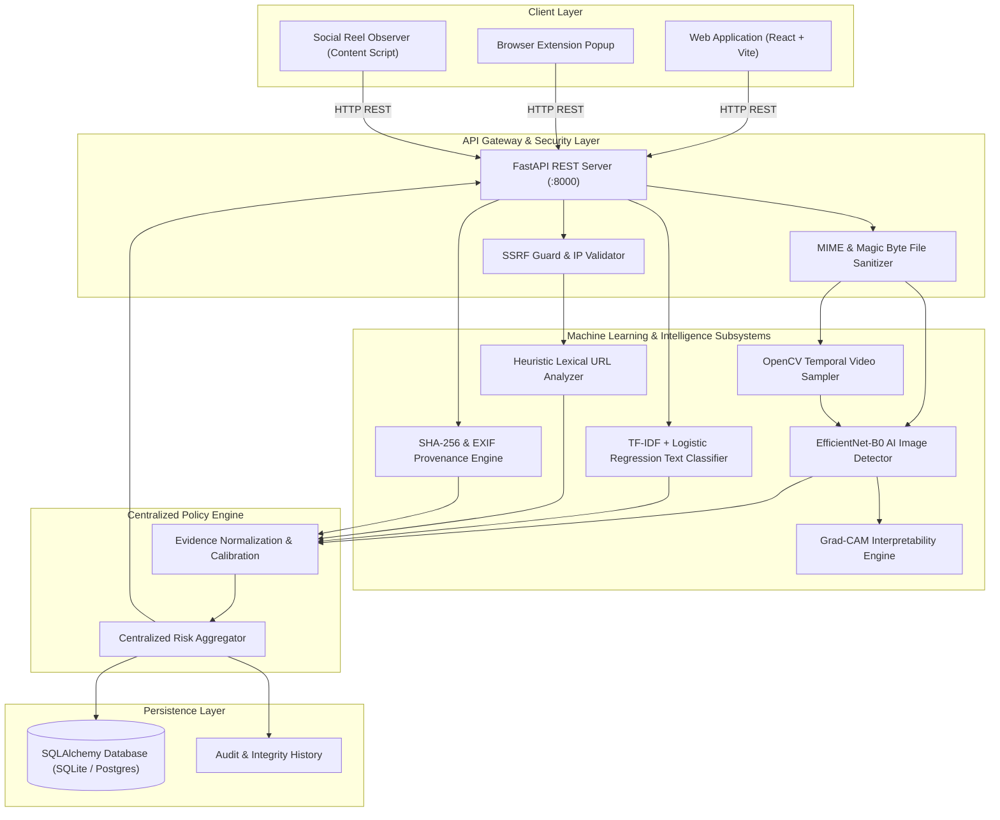
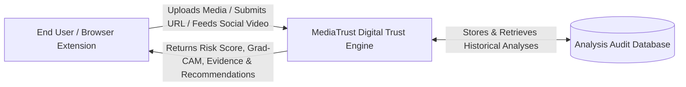
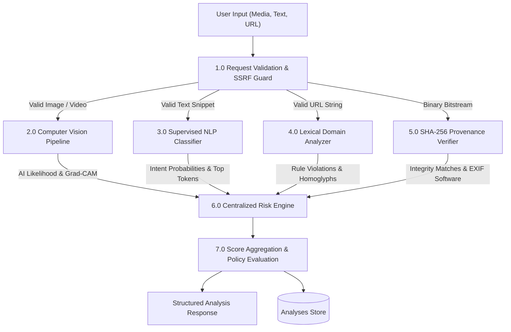
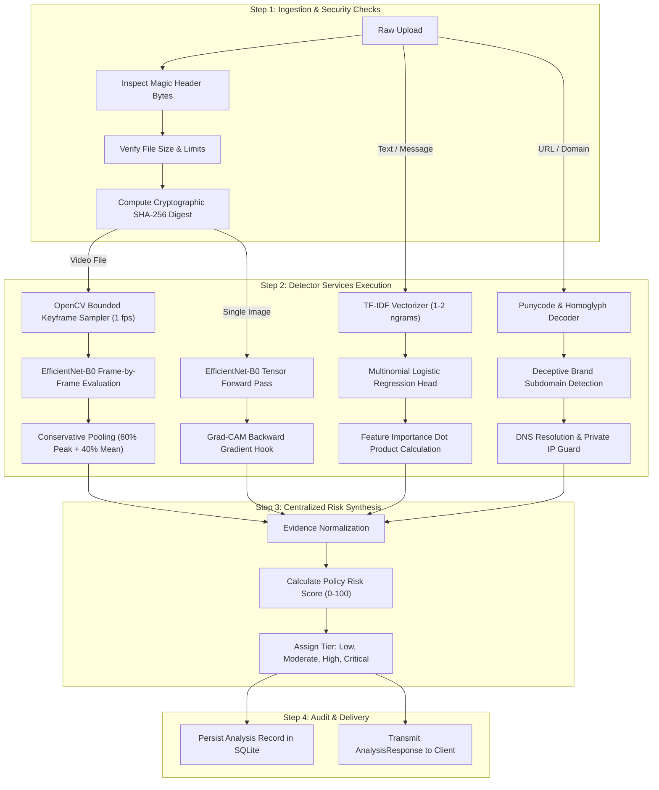
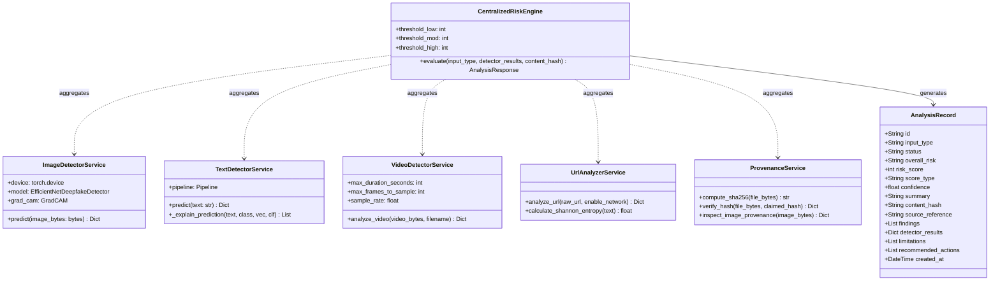
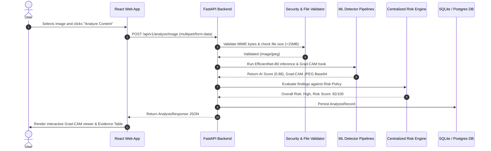
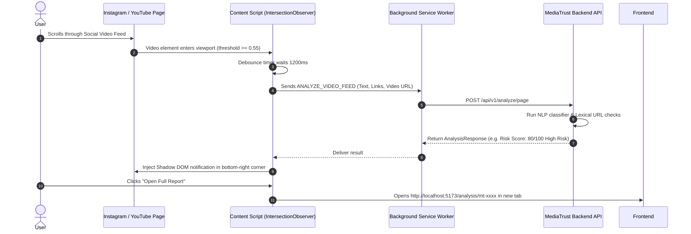
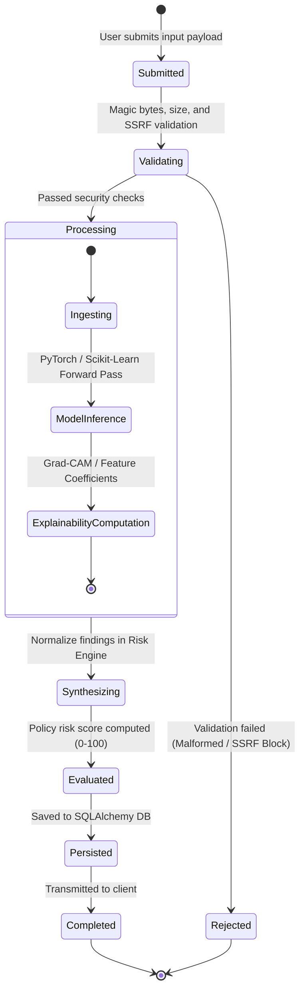
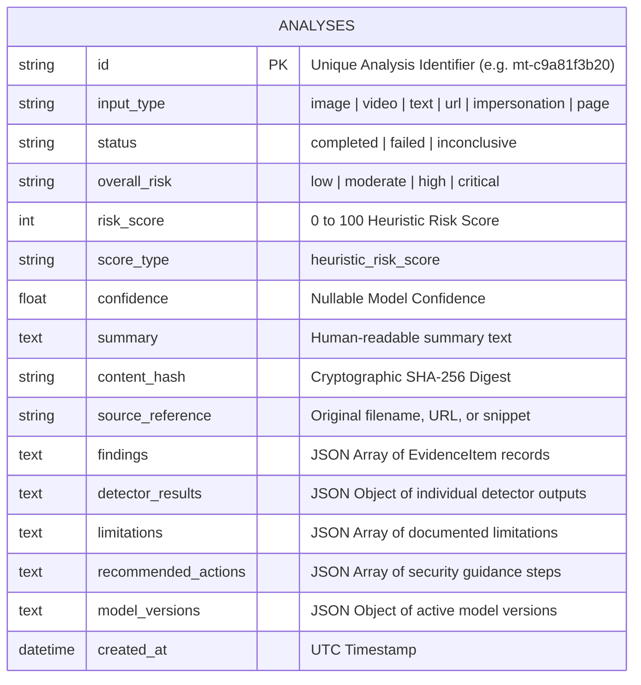

# MediaTrust: Software Architecture & Engineering Design Document

This document provides complete Software Engineering diagrams and technical specifications for the MediaTrust platform, prepared in accordance with third-year B.Tech Computer Science and Engineering capstone project standards.

---

## 1. System Context & Architecture Overview

MediaTrust follows a decoupled, three-tier micro-service architecture:
1. **Client Tier**: Web Client (React 18 + Vite + Tailwind CSS) and Chromium Browser Extension (Manifest V3).
2. **Application & Security Tier**: FastAPI asynchronous application gateway, SSRF validation filter, request sanitizer, and SQLAlchemy ORM.
3. **Machine Learning & Risk Intelligence Tier**: PyTorch transfer learning inference (EfficientNet-B0), Scikit-Learn TF-IDF pipeline, OpenCV temporal frame sampler, and the Centralized Risk Engine.

---

## 2. Data Flow Diagrams (DFD)

### Level 0 DFD (Context Diagram)

### Level 1 DFD (Subsystem Data Flow)

### Level 2 DFD (Detailed Analysis Pipeline)

---

## 3. UML Class Diagram

---

## 4. Sequence Diagrams

### Web Application Analysis Flow

### Browser Extension Automatic Social Reel Monitoring Flow

---

## 5. State Machine Diagram: Analysis Job Lifecycle

---

## 6. Database Entity-Relationship (ER) Diagram

